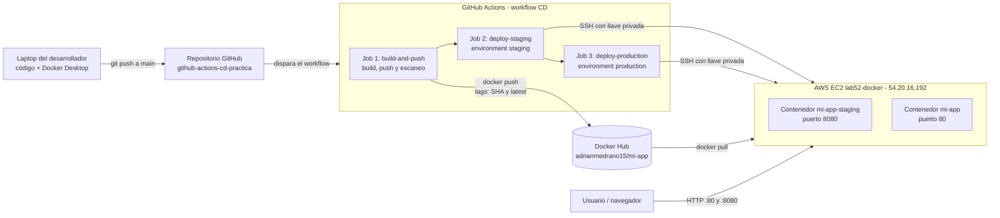
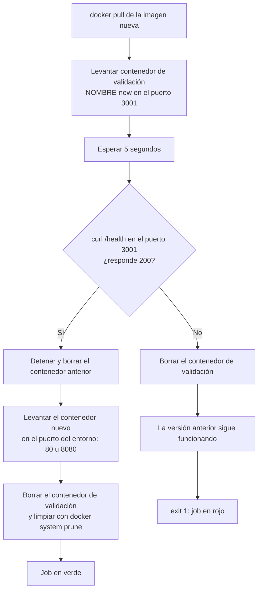

# Informe – Laboratorio 5.2: Configuración de un Pipeline de Despliegue Continuo con Docker

- **Estudiante:** Medrano Medrano Adrian Mijael
- **Usuario de GitHub:** MjlMedrano
- **Usuario de Docker Hub:** adrianmedrano15
- **Repositorio:** https://github.com/MjlMedrano/github-actions-cd-practica
- **Imagen en Docker Hub:** https://hub.docker.com/r/adrianmedrano15/mi-app
- **URL pública (production):** http://54.20.16.192/health
- **URL pública (staging):** http://54.20.16.192:8080/health

---

## 1. Descripción general

En el Laboratorio 5.1 se configuró **Integración Continua (CI)**: cada cambio se verificaba automáticamente con linting y pruebas. En este laboratorio se agrega **Despliegue Continuo (CD)**: cada cambio que llega a la rama `main` se **empaqueta en una imagen Docker**, se **publica en Docker Hub** y se **despliega automáticamente** en un servidor EC2 de AWS, sin intervención manual.

La aplicación desplegada es la **API REST CRUD de usuarios** del Laboratorio 5.1 (Node.js + Express), que expone el endpoint `GET /health` usado para validar que cada versión nueva está sana antes de ponerla en servicio.

El pipeline cumple con lo que pide la práctica:

| Requisito de la práctica | Cómo se cumplió |
|---|---|
| `Dockerfile` con multi-stage build | `Dockerfile` de dos etapas: `builder` y runtime |
| Workflow con al menos dos jobs | Tres jobs: `build-and-push`, `deploy-staging` y `deploy-production` |
| Push a Docker Hub con etiquetado por SHA | Cada imagen se publica con el SHA del commit y con `latest` |
| Despliegue automatizado en una instancia remota | EC2 `lab52-docker` (Ubuntu, t3.micro, región São Paulo) por SSH |
| Dos entornos con GitHub Environments | `staging` (puerto 8080) y `production` (puerto 80), cada uno con sus propios secrets y variables |
| Escaneo de vulnerabilidades | Trivy sobre la imagen publicada |

---

## 2. Arquitectura: cómo está conectado todo



**Recorrido de un cambio:**

1. El desarrollador hace `git push` a `main`.
2. GitHub Actions ejecuta el job **build-and-push**: construye la imagen con el `Dockerfile`, la sube a **Docker Hub** con dos etiquetas (el SHA del commit y `latest`) y la escanea con **Trivy**.
3. El job **deploy-staging** se conecta a la EC2 por **SSH** y ejecuta un script que descarga la imagen, la prueba con un **health check** y, si está sana, reemplaza el contenedor de staging (puerto 8080).
4. Solo si staging salió bien, el job **deploy-production** repite el proceso para el contenedor de production (puerto 80).
5. Los usuarios acceden a la aplicación por la IP pública de la EC2.

### Lógica del script de despliegue (health check)



---

## 3. Conceptos y tecnologías utilizadas

| Término | Qué es | Uso en este laboratorio |
|---|---|---|
| **CD (Despliegue Continuo)** | Publicar automáticamente en un servidor cada cambio que pasa las verificaciones | Cada push a `main` termina desplegado en la EC2 |
| **Docker** | Herramienta para empaquetar una aplicación con todo lo que necesita (runtime, dependencias, código) | Se empaquetó la API con Node.js 20 |
| **Imagen** | Plantilla de solo lectura con la aplicación lista para ejecutarse | `adrianmedrano15/mi-app` |
| **Contenedor** | Una instancia en ejecución de una imagen | `mi-app` (production) y `mi-app-staging` (staging) |
| **Dockerfile** | Archivo con las instrucciones para construir una imagen | Build de dos etapas |
| **Multi-stage build** | Usar varias etapas `FROM` y copiar a la imagen final solo lo necesario | La imagen final no incluye pruebas ni herramientas de desarrollo |
| **Docker Hub** | Registro público donde se almacenan y comparten imágenes | Almacén de todas las versiones de la imagen |
| **Tag (etiqueta)** | Nombre de una versión específica de una imagen | El SHA del commit y `latest` |
| **SHA del commit** | Identificador único de 40 caracteres de cada commit de Git | Identifica cada versión de la imagen y permite el rollback |
| **GitHub Secrets** | Valores confidenciales guardados cifrados en GitHub; en los logs aparecen como `***` | Token de Docker Hub y llave SSH |
| **GitHub Variables** | Valores de configuración no confidenciales | Nombre de la imagen, puerto y nombre del contenedor |
| **GitHub Environments** | Entornos de despliegue con nombre, cada uno con sus propios secrets, variables y reglas | `staging` y `production` |
| **Staging** | Entorno de ensayo donde se valida una versión antes de producción | Puerto 8080 |
| **Production** | Entorno que usan los usuarios reales | Puerto 80 |
| **SSH** | Protocolo de conexión remota segura mediante un par de llaves | GitHub Actions entra a la EC2 para desplegar |
| **Health check** | Verificación de que la aplicación responde correctamente | `curl` al endpoint `/health` |
| **Rollback** | Volver a una versión anterior que funcionaba | Volver a ejecutar una imagen por su SHA |
| **Trivy** | Escáner de vulnerabilidades conocidas (CVE) en imágenes de contenedores | Paso de escaneo del job `build-and-push` |
| **CVE** | Identificador público de una vulnerabilidad conocida | Por ejemplo, `CVE-2026-14456` en OpenSSL |
| **Elastic IP** | IP pública fija de AWS que no cambia al reiniciar la instancia | `54.20.16.192` |
| **Security Group** | Firewall virtual de AWS que define qué puertos aceptan conexiones | Puertos 22, 80 y 8080 abiertos |

---

## 4. Decisiones técnicas

| Decisión | Motivo |
|---|---|
| **Repositorio nuevo** (`github-actions-cd-practica`) con la API del Lab 5.1 | La práctica pide un repositorio propio. Además, el repositorio del Lab 5.1 tiene la rama `main` protegida y debía quedar intacto como entrega. Se copió también el workflow de CI, de modo que el repositorio verifica (CI) y despliega (CD) |
| **Una sola EC2 para los dos entornos**, con puertos distintos | Lo ideal en un entorno real son dos servidores separados. Para no duplicar costos, staging usa el puerto **8080** y production el **80**, cada uno con su contenedor. Para eso se crearon en cada environment las variables `APP_PORT` y `CONTAINER_NAME` |
| **El workflow de CD se dispara solo con `push` a `main`** (se quitó `pull_request` del ejemplo del lab) | Con `pull_request`, cada pull request desplegaría en el servidor código que todavía no fue aprobado y sobrescribiría la etiqueta `latest` |
| **Tres jobs encadenados con `needs`** | Production solo se despliega si el build y staging terminaron bien. Un error detectado en staging nunca llega a production |
| **Dos etiquetas por imagen: SHA y `latest`** | `latest` es la versión que se despliega. El SHA conserva cada versión de forma permanente y hace posible el rollback |
| **Trivy fijado por SHA de commit (versión 0.35.0)** en lugar de `@master` | En marzo de 2026, la action `aquasecurity/trivy-action` sufrió un ataque de cadena de suministro: se modificaron sus etiquetas de versión para ejecutar código que robaba credenciales. La versión 0.35.0 no fue afectada. Fijar la action por SHA garantiza que nadie pueda cambiar el código que se ejecuta, algo importante porque este workflow maneja la llave SSH y el token de Docker Hub |
| **`exit-code: '0'` en el escaneo** | El escaneo informa las vulnerabilidades pero no detiene el pipeline. Es la configuración del ejemplo del lab |
| **Access Token de Docker Hub** en lugar de la contraseña | El token tiene permisos limitados (Read & Write), vence y se puede revocar sin cambiar la contraseña de la cuenta |
| **Secretos SSH a nivel de environment** y secretos de Docker Hub a nivel de repositorio | Docker Hub es común a los dos entornos. Los datos SSH son propios de cada entorno: si production se mueve a otro servidor, solo se cambian sus secretos |
| **Línea extra `docker rm -f $NAME-new \|\| true`** al inicio del script de despliegue | Si una ejecución anterior se interrumpe a la mitad, el contenedor de validación queda huérfano y bloquea el siguiente despliegue |
| **Puerto 22 abierto a `0.0.0.0/0`** | GitHub Actions se conecta desde direcciones IP que cambian en cada ejecución. La seguridad del acceso la da la llave privada `.pem` |

---

## 5. Procedimiento, comandos utilizados y evidencias

### 5.1 Preparación del entorno local

| Herramienta | Para qué se usó |
|---|---|
| **WSL 2** (Subsistema de Windows para Linux) | Requisito de Docker Desktop en Windows: ejecuta el motor de Docker sobre un kernel Linux |
| **Docker Desktop** | Construir y probar la imagen en la laptop antes de publicarla |
| **Cuenta de Docker Hub** + **Access Token** | Almacenar las imágenes. El token se creó en *Account settings → Personal access tokens* con permiso **Read & Write** |

| Comando (PowerShell como administrador) | Para qué se usó |
|---|---|
| `wsl --update` | Actualizar WSL a la última versión |
| `wsl --status` | Verificar que la versión predeterminada de WSL es la 2 |
| `docker --version` | Verificar la instalación de Docker |
| `docker run hello-world` | Probar que Docker puede descargar y ejecutar una imagen |

### 5.2 Preparación del servidor (AWS EC2)

Se lanzó la instancia **`lab52-docker`**: Ubuntu Server 24.04 LTS, tipo **t3.micro**, región **São Paulo (sa-east-1)**, con un par de llaves nuevo `lab52-key.pem`.

**Security Group:** reglas de entrada para SSH (22), HTTP (80) y el puerto de staging (8080):


| Puerto | Origen | Para qué |
|---|---|---|
| 22 (SSH) | 0.0.0.0/0 | Conexión del desarrollador y de GitHub Actions |
| 80 (HTTP) | 0.0.0.0/0 | Aplicación en production |
| 8080 (TCP) | 0.0.0.0/0 | Aplicación en staging |

**Instancia en ejecución** con la Elastic IP asociada:


**Elastic IP** `54.20.16.192` asociada a la instancia, para que la IP no cambie si la instancia se reinicia:


**Instalación de Docker en la EC2:**

| Comando | Dónde | Para qué se usó |
|---|---|---|
| `ssh -i "lab52-key.pem" ubuntu@54.20.16.192` | Laptop (PowerShell) | Conectarse a la EC2 con la llave privada |
| `curl -fsSL https://get.docker.com \| sudo sh` | EC2 | Descargar y ejecutar el script oficial de instalación de Docker |
| `sudo usermod -aG docker ubuntu` | EC2 | Agregar el usuario `ubuntu` al grupo `docker` para usar Docker **sin `sudo`**. Es necesario porque el script de despliegue ejecuta comandos `docker` sin `sudo` |
| `exit` y volver a conectarse | EC2 | Aplicar el cambio de grupo, que solo se activa en una sesión nueva |
| `docker --version` / `docker run hello-world` | EC2 | Verificar que Docker funciona sin `sudo` |


### 5.3 Contenerización de la aplicación (Dockerfile y prueba local)

Se creó el repositorio `github-actions-cd-practica` y se copiaron desde el Lab 5.1 los archivos `app.js`, `server.js`, `app.test.js`, `package.json`, `package-lock.json`, `eslint.config.js`, `.gitignore` y la carpeta `.github` con el workflow de CI.

| Comando | Para qué se usó |
|---|---|
| `git clone https://github.com/MjlMedrano/github-actions-cd-practica.git` | Descargar el repositorio nuevo |
| `npm ci` | Instalar las dependencias exactas del `package-lock.json` |
| `npm test` / `npm run lint` | Verificar que la API copiada sigue funcionando (11 pruebas y linting) |

**Dockerfile (multi-stage):**

```dockerfile
# Etapa 1: Build
FROM node:20-alpine AS builder
WORKDIR /app
COPY package*.json ./
RUN npm ci --only=production
COPY . .

# Etapa 2: Runtime
FROM node:20-alpine
WORKDIR /app
COPY --from=builder /app/node_modules ./node_modules
COPY --from=builder /app/package*.json ./
COPY --from=builder /app/app.js ./
COPY --from=builder /app/server.js ./
EXPOSE 3000
CMD ["node", "server.js"]
```

| Instrucción | Qué hace |
|---|---|
| `FROM node:20-alpine AS builder` | Parte de una imagen oficial con Node.js 20 sobre Alpine Linux, una distribución muy liviana. `AS builder` nombra esta primera etapa |
| `WORKDIR /app` | Crea la carpeta de trabajo `/app` dentro de la imagen y se ubica en ella |
| `COPY package*.json ./` | Copia `package.json` y `package-lock.json`. Se copian antes que el resto del código para aprovechar la **caché de Docker**: si las dependencias no cambian, no se vuelven a instalar |
| `RUN npm ci --only=production` | Instala solo las dependencias de producción (Express). Jest, Supertest y ESLint quedan fuera |
| `COPY . .` | Copia el resto del proyecto (filtrado por `.dockerignore`) |
| `FROM node:20-alpine` | Inicia la **segunda etapa** desde una imagen limpia |
| `COPY --from=builder ...` | Toma de la primera etapa **solo** lo necesario para ejecutar la API: `node_modules`, `package*.json`, `app.js` y `server.js` |
| `EXPOSE 3000` | Documenta que la aplicación escucha en el puerto 3000 |
| `CMD ["node", "server.js"]` | Comando que se ejecuta al iniciar el contenedor |

**`.dockerignore`:** evita que entren en la imagen archivos innecesarios o sensibles, como el `node_modules` local, el historial de Git o un posible `.env`.

```text
node_modules
npm-debug.log
.git
.github
.env
Dockerfile
.dockerignore
```

**Construcción de la imagen en local:**

| Comando | Para qué se usó |
|---|---|
| `docker build -t mi-app:local .` | Construir la imagen siguiendo el `Dockerfile`. `-t` le asigna nombre y etiqueta, y `.` indica la carpeta de contexto |


**Ejecución y prueba del contenedor en local:**

| Comando | Para qué se usó |
|---|---|
| `docker run -d -p 3000:3000 --name app-local mi-app:local` | Ejecutar el contenedor en segundo plano (`-d`), conectando el puerto 3000 de la laptop con el 3000 del contenedor (`-p laptop:contenedor`) |
| `curl.exe http://localhost:3000/health` | Probar el endpoint. Respondió `{"status":"ok"}` |
| `docker images mi-app` | Ver el tamaño de la imagen: **49.1 MB** comprimida (199 MB en disco) |
| `docker stop app-local` / `docker rm app-local` | Detener y eliminar el contenedor de prueba |


| Comando | Para qué se usó |
|---|---|
| `git add .` / `git commit -m "feat: agrega API CRUD con Dockerfile multi-stage"` / `git push origin main` | Subir la API, el `Dockerfile` y el `.dockerignore` |
| `git mv dockerfile Dockerfile` | Renombrar el archivo, que se había creado en minúsculas (ver la lección aprendida en la sección 8) |

### 5.4 Secretos, variables y entornos

**Secrets del repositorio** (*Settings → Secrets and variables → Actions → Secrets*). Sus valores no se pueden ver después de guardarlos:

| Secret | Contenido |
|---|---|
| `DOCKER_USERNAME` | Usuario de Docker Hub |
| `DOCKER_PASSWORD` | Access Token de Docker Hub (no la contraseña de la cuenta) |


**Variable del repositorio** (no es confidencial):

| Variable | Valor |
|---|---|
| `IMAGE_NAME` | `adrianmedrano15/mi-app` |


**GitHub Environments** (*Settings → Environments*). Cada entorno tiene sus propios secrets y variables:

| | `staging` | `production` |
|---|---|---|
| Secret `SSH_HOST` | IP de la EC2 | IP de la EC2 |
| Secret `SSH_USER` | `ubuntu` | `ubuntu` |
| Secret `SSH_PRIVATE_KEY` | Contenido completo de `lab52-key.pem` | Contenido completo de `lab52-key.pem` |
| Variable `APP_PORT` | `8080` | `80` |
| Variable `CONTAINER_NAME` | `mi-app-staging` | `mi-app` |

Environment `staging`:


Environment `production`:


### 5.5 Workflow de CD (`.github/workflows/cd.yml`)

```yaml
name: CD - Build, Push and Deploy

on:
  push:
    branches: [main]

jobs:
  build-and-push:
    runs-on: ubuntu-latest

    env:
      FORCE_JAVASCRIPT_ACTIONS_TO_NODE24: true

    steps:
      - name: Checkout del codigo
        uses: actions/checkout@v6

      - name: Login a Docker Hub
        uses: docker/login-action@v3
        with:
          username: ${{ secrets.DOCKER_USERNAME }}
          password: ${{ secrets.DOCKER_PASSWORD }}

      - name: Build y Push de la imagen
        uses: docker/build-push-action@v5
        with:
          context: .
          push: true
          tags: |
            ${{ vars.IMAGE_NAME }}:${{ github.sha }}
            ${{ vars.IMAGE_NAME }}:latest

      - name: Escaneo de vulnerabilidades
        uses: aquasecurity/trivy-action@57a97c7e7821a5776cebc9bb87c984fa69cba8f1 # v0.35.0
        with:
          image-ref: ${{ vars.IMAGE_NAME }}:${{ github.sha }}
          format: 'table'
          exit-code: '0'
          ignore-unfixed: true
          vuln-type: 'os,library'
          severity: 'CRITICAL,HIGH'

  deploy-staging:
    needs: build-and-push
    runs-on: ubuntu-latest
    environment: staging
    steps:
      - name: Desplegar en staging
        uses: appleboy/ssh-action@v1.0.0
        with:
          host: ${{ secrets.SSH_HOST }}
          username: ${{ secrets.SSH_USER }}
          key: ${{ secrets.SSH_PRIVATE_KEY }}
          script: |
            # (script de despliegue con health check, ver explicación abajo)

  deploy-production:
    needs: deploy-staging
    runs-on: ubuntu-latest
    environment: production
    steps:
      - name: Desplegar en produccion
        uses: appleboy/ssh-action@v1.0.0
        with:
          host: ${{ secrets.SSH_HOST }}
          username: ${{ secrets.SSH_USER }}
          key: ${{ secrets.SSH_PRIVATE_KEY }}
          script: |
            # (mismo script de despliegue con health check)
```

El archivo completo está en [`.github/workflows/cd.yml`](./.github/workflows/cd.yml).

**Explicación de las partes del workflow:**

| Parte | Qué hace |
|---|---|
| `on: push: branches: [main]` | El workflow se ejecuta en cada push a `main` |
| `runs-on: ubuntu-latest` | Cada job corre en una máquina virtual Linux limpia que proporciona GitHub |
| `FORCE_JAVASCRIPT_ACTIONS_TO_NODE24: true` | Obliga a las actions programadas para Node.js 20 (obsoleto en los runners) a ejecutarse con Node.js 24 |
| `actions/checkout@v6` | Descarga el código del commit que disparó el workflow |
| `docker/login-action@v3` | Inicia sesión en Docker Hub con los secrets, para tener permiso de subir imágenes |
| `docker/build-push-action@v5` | Construye la imagen con el `Dockerfile` (`context: .`) y la sube (`push: true`) con dos etiquetas: `${{ github.sha }}` y `latest` |
| `aquasecurity/trivy-action` | Escanea la imagen recién publicada en busca de vulnerabilidades **CRITICAL** y **HIGH** del sistema operativo (`os`) y de las librerías (`library`). `ignore-unfixed: true` muestra solo las que tienen corrección disponible, y `exit-code: '0'` hace que el escaneo informe sin detener el pipeline |
| `needs: build-and-push` / `needs: deploy-staging` | Encadena los jobs: staging espera al build y production espera a staging. Si un job falla, los siguientes no se ejecutan |
| `environment: staging` / `environment: production` | Indica qué environment usa el job, y con eso qué secrets (`secrets.SSH_*`) y variables (`vars.APP_PORT`, `vars.CONTAINER_NAME`) recibe |
| `appleboy/ssh-action@v1.0.0` | Se conecta a la EC2 por SSH con el host, el usuario y la llave de los secrets, y ejecuta el `script` en el servidor |

**Script de despliegue** (se ejecuta en la EC2; es el script del lab, parametrizado con las variables de cada environment):

```bash
IMAGE="${{ vars.IMAGE_NAME }}:latest"
NAME="${{ vars.CONTAINER_NAME }}"
PORT="${{ vars.APP_PORT }}"

# 0. Eliminar un contenedor de validacion que haya quedado de una ejecucion anterior
docker rm -f $NAME-new || true

# 1. Desplegar la nueva imagen en un puerto alterno (3001) para validacion
docker pull $IMAGE
docker run -d --name $NAME-new --restart unless-stopped -p 3001:3000 $IMAGE

# 2. Esperar a que el contenedor inicialice
sleep 5

# 3. Health check
if curl -sf http://localhost:3001/health; then
  echo "Health check exitoso. Activando nuevo contenedor..."
  docker stop $NAME || true                      # 4. Detener el contenedor viejo
  docker rm $NAME || true
  docker run -d --name $NAME --restart unless-stopped -p $PORT:3000 $IMAGE   # 5. Exponer el nuevo
  docker rm -f $NAME-new || true                 # 6. Limpiar el de validación
else
  echo "Health check FALLIDO. Cancelando despliegue y manteniendo version anterior."
  docker rm -f $NAME-new || true
  exit 1
fi

# 7. Limpieza de imagenes y contenedores huerfanos
docker system prune -f
```

| Comando del script | Para qué sirve |
|---|---|
| `docker pull $IMAGE` | Descarga desde Docker Hub la versión más reciente de la imagen |
| `docker run -d --name $NAME-new -p 3001:3000 $IMAGE` | Levanta la versión nueva en un **puerto de validación** (3001), sin tocar la versión que está en servicio |
| `--restart unless-stopped` | Docker reinicia el contenedor automáticamente si se cae o si se reinicia la EC2 |
| `sleep 5` | Da tiempo a que la aplicación arranque |
| `curl -sf http://localhost:3001/health` | **Health check**: `-s` es modo silencioso y `-f` hace que el comando falle si la respuesta no es exitosa (código 4xx o 5xx, o sin respuesta) |
| `docker stop` / `docker rm` | Detienen y eliminan el contenedor de la versión anterior |
| `-p $PORT:3000` | Publica la versión nueva en el puerto del entorno: 8080 en staging, 80 en production |
| `\|\| true` | Si el comando falla (por ejemplo, porque en el primer despliegue no existe un contenedor anterior), el script continúa |
| `exit 1` | Marca el job como fallido cuando el health check no pasa |
| `docker system prune -f` | Elimina imágenes y contenedores que ya no se usan, para no llenar el disco de la EC2 |

**Subida del workflow:**

| Comando | Para qué se usó |
|---|---|
| `git add .github/workflows/cd.yml` | Preparar el workflow |
| `git commit -m "cd: agrega pipeline de CD con Docker, escaneo y despliegue a staging y production"` | Registrar el cambio |
| `git push origin main` | Subirlo; el push disparó la primera ejecución del pipeline |

### 5.6 Ejecución del pipeline (evidencias por fase)

**Primera ejecución (#1):** los tres jobs terminaron con éxito en **1 min 18 s** (build-and-push 33 s, deploy-staging 19 s, deploy-production 18 s):


**Fase build-and-push:** checkout, login a Docker Hub, build y push, y escaneo:


**Fase deploy-production:** conexión por SSH y despliegue:


**Imagen publicada en Docker Hub** con las dos etiquetas: `latest` y el SHA del commit `7f395f18af448f1fefa0f11a6a03410f9fd6c319`, con un tamaño comprimido de **46.8 MB**:


**Aplicación funcionando en la instancia remota:** production (puerto 80) arriba y staging (puerto 8080) abajo:


---

## 6. Escaneo de vulnerabilidades

El paso **Escaneo de vulnerabilidades** analizó la imagen `mi-app:7f395f18...`:


| Capa analizada | Resultado |
|---|---|
| Sistema operativo (Alpine 3.23.4) | **7 vulnerabilidades HIGH**, 0 CRITICAL: en `libcrypto3` y `libssl3` (OpenSSL), `musl`, `musl-utils` y `zlib` |
| Librerías de Node.js (`node-pkg`) | **22 vulnerabilidades**: 21 HIGH y 1 CRITICAL |

**Análisis:**

- Todas las vulnerabilidades reportadas tienen una **versión corregida** disponible (`Fixed Version`), porque el escaneo usa `ignore-unfixed: true`.
- Las vulnerabilidades del sistema operativo vienen de la **imagen base** `node:20-alpine`, no del código de la aplicación. Se corrigen reconstruyendo la imagen sobre una versión actualizada de la imagen base.
- Con `exit-code: '0'`, el escaneo **informa pero no bloquea** el despliegue, que es la configuración del ejemplo del lab.
- **Mejoras para un entorno real:** usar `exit-code: '1'` con `severity: 'CRITICAL'` para que una vulnerabilidad crítica detenga el pipeline antes de desplegar, actualizar periódicamente la imagen base y revisar las librerías Node.js señaladas en el reporte.

---

## 7. Verificación del despliegue, simulación de fallo y rollback

### 7.1 Despliegue de una nueva versión (2.0.0)

Se modificó el endpoint `/health` en `app.js`:

```javascript
app.get('/health', (req, res) => {
  res.status(200).json({ status: 'ok', version: '2.0.0' });
});
```

| Comando | Para qué se usó |
|---|---|
| `git add app.js` / `git commit -m "feat: actualiza mensaje de health check"` / `git push origin main` | Subir el cambio; el pipeline se disparó automáticamente |

La ejecución **#2** terminó con éxito en **1 min 38 s**:


La versión nueva quedó publicada **sin ningún paso manual**:


### 7.2 Simulación de fallo del health check

Para simular un error que impide que la aplicación responda, en `server.js` se cambió el puerto interno de **3000** a **4000**:

```javascript
const PORT = process.env.PORT || 4000;
```

Dentro del contenedor, la aplicación pasó a escuchar en el puerto 4000, pero el script de despliegue conecta el puerto **3000** del contenedor (`-p 3001:3000`). Por eso el `curl` al `/health` no obtiene respuesta.

**Dato importante:** este error **no lo detectan las pruebas del CI**, porque Supertest prueba `app.js` directamente sin abrir ningún puerto. El health check es una protección que el CI no ofrece.

| Comando | Para qué se usó |
|---|---|
| `git add server.js` / `git commit -m "test: forzar el fallo de health check el puerto"` / `git push origin main` | Subir la versión defectuosa |

**Resultado (ejecución #3):** `build-and-push` pasó, `deploy-staging` **falló** en el health check y `deploy-production` **no se ejecutó**, gracias a `needs`:


Después del fallo, **la aplicación siguió funcionando con la versión anterior (2.0.0)**, porque el script nunca llegó a reemplazar el contenedor activo:


Luego se corrigió el error restaurando el puerto 3000:

| Comando | Para qué se usó |
|---|---|
| `git add server.js` / `git commit -m "fix: restaura puerto 3000 del servidor"` / `git push origin main` | Subir la corrección y volver a desplegar |

### 7.3 Rollback a una versión anterior

**Cuándo se necesita:** el health check impide desplegar versiones que no arrancan. Pero si un error aparece después (por ejemplo, `/health` responde bien pero otro endpoint devuelve datos incorrectos), hay que volver a la versión anterior.

**Por qué es posible:** cada imagen se publicó en Docker Hub con el **SHA de su commit**, así que todas las versiones anteriores siguen disponibles.

**Procedimiento:**

1. Identificar el SHA de la versión a la que se quiere volver. En la laptop, dentro del repositorio:

    ```powershell
    git log --format="%H  %s" -6
    ```

    También se puede ver en Docker Hub, en la pestaña **Tags** del repositorio `adrianmedrano15/mi-app`.

2. Conectarse a la EC2 y ejecutar:

    ```bash
    docker pull adrianmedrano15/mi-app:SHA_ANTERIOR
    docker stop mi-app
    docker rm mi-app
    docker run -d --name mi-app --restart unless-stopped -p 80:3000 adrianmedrano15/mi-app:SHA_ANTERIOR
    ```

| Comando | Para qué sirve |
|---|---|
| `docker pull ...:SHA_ANTERIOR` | Descarga la versión anterior identificada por su SHA |
| `docker stop mi-app` / `docker rm mi-app` | Detiene y elimina el contenedor actual de production |
| `docker run ... :SHA_ANTERIOR` | Levanta production con la versión anterior en el puerto 80 |

**Rollback realizado:** production volvió a la versión del commit `7f395f18af448f1fefa0f11a6a03410f9fd6c319`, anterior a la 2.0.0:


Production volvió a responder sin el campo `version`, es decir, con la versión anterior:


Para volver a la última versión basta con repetir los mismos comandos usando la etiqueta `latest`, o hacer un nuevo push a `main` para que el pipeline la despliegue.

**Conclusión:** el **health check** evita que una versión rota reemplace a la que funciona, y el **etiquetado por SHA** permite revertir en segundos si un problema se descubre después. Las dos estrategias juntas hacen el pipeline mucho más seguro.

---

## 8. Lección aprendida: mayúsculas en el nombre del Dockerfile

El `Dockerfile` se creó primero como `dockerfile`, en minúsculas:


En Windows funcionó, porque su sistema de archivos no distingue mayúsculas de minúsculas. Pero los runners de GitHub Actions usan Linux, que sí las distingue, y el nombre estándar que busca Docker es `Dockerfile`. Se corrigió con `git mv dockerfile Dockerfile`, ya que en Windows un cambio que solo afecta a mayúsculas no lo detecta Git si se hace desde el Explorador.

Es otro ejemplo de por qué conviene que el pipeline corra en un entorno limpio y distinto al del desarrollador: detecta diferencias que en la máquina local pasan desapercibidas.

---

## 9. Reflexión: ventajas de los contenedores y el despliegue continuo

- **Mismo entorno en todas partes.** La imagen Docker incluye la versión exacta de Node.js, las dependencias y el código. Lo que se probó en la laptop es exactamente lo que corre en la EC2, y desaparece el "en mi máquina funciona".
- **Despliegues rápidos y sin pasos manuales.** Un cambio en el código llegó a producción en menos de dos minutos con un `git push`, sin conectarse al servidor ni ejecutar comandos a mano. Eso reduce los errores humanos y permite publicar mejoras con frecuencia.
- **Seguridad ante versiones defectuosas.** El health check impidió que una versión que no arrancaba reemplazara a la que funcionaba, y los usuarios nunca vieron la aplicación caída. Además, encadenar staging y production hace que un error se detecte en staging antes de llegar a los usuarios.
- **Capacidad de volver atrás.** Al etiquetar cada imagen con el SHA del commit, todas las versiones quedan guardadas en Docker Hub y un rollback se hace con cuatro comandos.
- **Manejo seguro de credenciales.** Con GitHub Secrets, el token de Docker Hub y la llave SSH nunca aparecen en el código, aunque el repositorio sea público. El incidente de Trivy de 2026 muestra que en un pipeline también hay que cuidar la confianza en las herramientas de terceros, por ejemplo fijando las actions por SHA.
- **Imágenes livianas.** El build multi-stage dejó una imagen de unos 47 MB comprimida, sin pruebas ni herramientas de desarrollo, lo que acelera las descargas y reduce la superficie de ataque.
- **Detección temprana de vulnerabilidades.** El escaneo con Trivy hace visibles los problemas de seguridad de la imagen en cada despliegue, sin esfuerzo adicional.

En un proyecto real, como los sistemas que se desarrollan en una unidad de informática, esta forma de trabajar permite entregar cambios de forma frecuente, controlada y reversible, con menos riesgo para los usuarios.

---

## 10. Entrega

- **Repositorio:** https://github.com/MjlMedrano/github-actions-cd-practica
- **URL pública de production:** http://54.20.16.192/health — también http://54.20.16.192/users
- **URL pública de staging:** http://54.20.16.192:8080/health
- **Imagen en Docker Hub:** https://hub.docker.com/r/adrianmedrano15/mi-app
